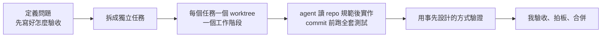

# Miska Wu

18 年遊戲業軟體工程師，以後端（Go）為本，近年延伸到平台、維運與遊戲客戶端。現在我用 Claude Code 作為主要的開發方式，這一頁說明我怎麼跟 AI 一起工作。

簡單說，問題定義、設計取捨和驗收標準由我負責，實作交給幾個同時進行的 Claude Code 工作階段。2026 年 7 月到 10 月這 11 週，我的主力機累計開了約 1,000 個工作階段。

## 一件工作怎麼跑

1. 先寫好「怎麼證明做對了」再開工。驗收方式動手前就定好，做完才有東西可以對。
2. 一個任務開一個 worktree。worktree 是同一個 repo 的獨立工作副本，多個工作階段並行時不會互相踩到。我做了 canopy，在輸入框上方就能看到每個分支還有幾個 commit 沒推。
3. 規範寫在 repo 裡給 agent 讀。每個 repo 的 CLAUDE.md 記下架構決策、測試指令和不能做的事。這份文件我會定期對照實際狀況瘦身，有一份就從 577 行砍到 183 行，只留決策。
4. commit 前跑全套測試，不縮範圍。實測全套只要 15 秒；只跑改動所在的套件雖然只要 0.4 秒，但改的是底層程式時，它正好最不可信。

## 護欄：只守不可逆的事

原則是：會造成不可逆傷害的操作，例如推送、關單、金鑰，用程式強制擋下；其他判斷交給模型，實際觀察到不足，再加最小限度的提示。原因是模型進步很快，寫死的判斷規則，等於用今天的水準替明天的模型畫地板。

- agent 在自己的 worktree 裡不能推送。放行的開關只有我能打開，agent 寫不到那個設定；如果它寫得到，這道防線就等於不存在。（[claude-kit](https://github.com/MiskaWu/claude-kit)）
- canopy 就算開啟了推送，也要我親手按下按鈕才會執行，模型沒有辦法代按。（[canopy](https://github.com/MiskaWu/canopy)）
- 會印出 token 的指令一律擋下，因為 token 一進對話就等於外洩。baton 把指令結果交回給 Claude 之前，也會先把金鑰遮掉。（[claude-kit](https://github.com/MiskaWu/claude-kit)、[baton](https://github.com/MiskaWu/baton)）
- braid 在多個 Claude 帳號之間同步對話，登入憑證全程不經過模型，也不繞過公司的登入政策。（[braid](https://github.com/MiskaWu/braid)）

## 驗收：不靠自我回報

「AI 說做完了」不算完成，要有可以驗證的證據：

- 驗收指令由另一個工作階段重跑。做的和驗的不是同一個，避免自己做、自己驗。
- 看實際產出，不看工具怎麼說。easel 判斷生圖成功，是看資料夾裡有沒有多出新圖，不採信工具的事件紀錄。（[easel](https://github.com/MiskaWu/easel)）
- 重構前後要比對。起兩個環境跑同一支客戶端，比對 42 則協定訊息完全一致，才確定重構沒有改到行為。
- 測試本身要抓得到錯。用變異測試（故意把程式改壞，看測試抓不抓得到）和負向驗證確認測試有效。我曾在盤點時發現 47 支端到端測試只有 4 支真的在跑，其餘都被靜默略過；第一次真的連上伺服器跑，17 支失敗，另有 2 支沒測到東西卻顯示通過。清掉過期的測試後，留下的 35 支全部修到通過。

## 從事故學到的規則

- 多個工作階段共用一份工作副本時，曾把別人的改動掃進自己的 commit。之後改成一個任務一個 worktree、只 stage 自己的改動、推送前確認主線頂端是自己的 commit。
- 設定「回報成功卻沒生效」，例如防火牆規則存在但流量根本不經過它、部署工具顯示已同步但物件其實沒建出來。之後一律從流量實際經過的那一側驗證。
- 修 bug 先分辨是單點錯誤，還是結構上的縫。是縫的話就提出重新設計，並收緊當初讓 bug 溜過去的測試。

## 留下紀錄

- 每個工作階段結束時，自動蒸餾成工作日誌，每晚整併，再用可執行的指標追蹤目標進度。（[journal](https://github.com/MiskaWu/journal)）
- 重要的技術決策都寫下理由，以及什麼情況下要翻案。

## 作品

| 作品 | 是什麼 |
|---|---|
| [SinShot](https://sinshot.com) | 我自己做的網頁小遊戲站，2026 年 10 月開始，一個多月上線四款。伺服器和遊戲核心用 Rust 寫，核心編成 WebAssembly，瀏覽器判定和伺服器防作弊重算共用同一份程式。[歐印FX](https://ouin-fx.sinshot.com/) 累計約 1,500 個裝置開過局，兩百多個在不同天回來玩過。玩家數據的統計是自己做的，四款都跑在下面的 aws-iac-platform 上 |
| [footnote](https://github.com/MiskaWu/footnote) | 只回答有出處內容的團隊文件問答機器人（Go）。檢索結合向量與全文搜尋，再用自架的重排序模型排序；文件裡沒有答案或引用對不上就回「沒有資料」。查不到的問題由 agent 寫成 FAQ 卡提案，人核准才上線 |
| [piper](https://github.com/MiskaWu/piper) | 同時指揮多個 Claude Code 工作階段的本機儀表板（Go 加 React，單一執行檔）。任務做完要由另一個工作階段重跑驗收指令才算完成，後端 859 個測試函式 |
| [onebox](https://github.com/MiskaWu/onebox) | 用 Ansible 把一台 Linux 主機建成小團隊的開發平台：HTTPS 入口、GitLab 與 CI、單一登入、密鑰管理、共用資料庫、GitOps 管理的 k3s。不開虛擬機就能渲染並驗證 11 種情境的設定，設計理由寫成 26 篇架構決策紀錄 |
| [braid](https://github.com/MiskaWu/braid) | Claude 多帳號切換與對話同步工具（Claude Code 擴充套件），同事也在用，179 條測試 |
| [canopy](https://github.com/MiskaWu/canopy) | 多個 Claude Code 工作階段並行時的 git 線圖與推送控制，37 條測試 |
| [baton](https://github.com/MiskaWu/baton) | 把 Claude 交辦的指令變成卡片，一鍵以本人身分執行並安全回報 |
| [easel](https://github.com/MiskaWu/easel) | 讓 Claude 呼叫官方 Codex 生圖，修改接回同一段對話，人只在 Claude Code 的面板上看圖、核准，也管理版本 |
| [claude-kit](https://github.com/MiskaWu/claude-kit) | 讓 AI 寫程式時能放手又不越界的防護規則，138 條回歸測試 |
| [aws-iac-platform](https://github.com/MiskaWu/aws-iac-platform) | 用 OpenTofu 管理的 AWS 帳號與多專案共用主機，帳號中不存長期金鑰 |
| [dev-env-ansible](https://github.com/MiskaWu/dev-env-ansible) | 一個指令建好 Claude Code 開發機的 Ansible role |
| 其他 | [taskwire](https://github.com/MiskaWu/taskwire)（GitLab 工單驅動 Claude）、[journal](https://github.com/MiskaWu/journal)（工作日誌與目標追蹤）、[dbshift](https://github.com/MiskaWu/dbshift)（MySQL 遷 PostgreSQL 與資料核對）、[formgen](https://github.com/MiskaWu/formgen)（試算表轉資料定義）、[wsl-bootstrap](https://github.com/MiskaWu/wsl-bootstrap) |
